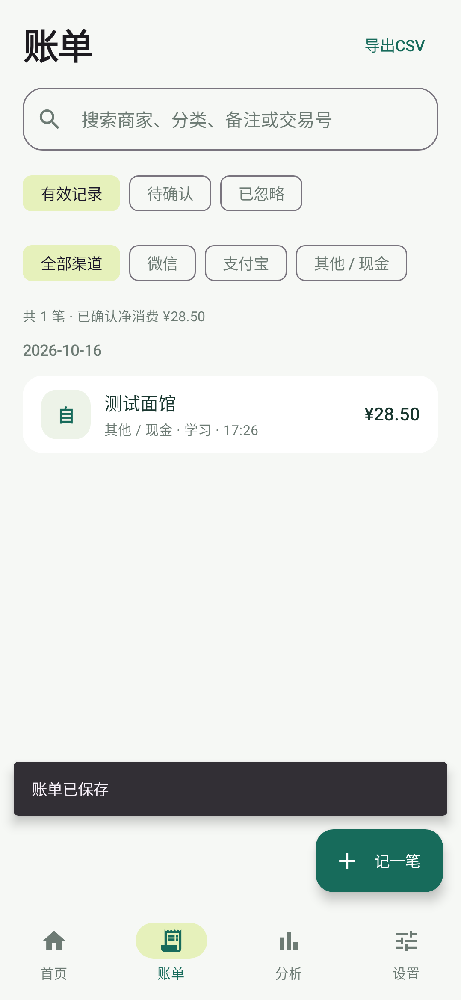

# 清记 · Android 记账

把每一笔，记清楚。

- [下载与安装](https://fyy-cn.github.io/qingji-releases/)
- [最新版本、APK与源码包](https://github.com/fyy-cn/qingji-releases/releases/latest)
- [Android应用源码](android/) · [构建说明](android/README.md)

清记支持可选的支付页面识别实验（默认关闭）、微信/支付宝支付候选通知记账、账单导入、手动补记、自定义分类、分类排序与删除、日周月年分析、CSV导出和口令加密备份。账本保存在本机，联网仅用于版本检查与安装包下载。

## 仓库内容

- `android/`：Kotlin / Jetpack Compose / Room应用源码、测试和合成账单样例，含Gradle Wrapper。
- `docs/`：GitHub Pages下载页、界面截图、公开版本清单。
- Releases：同一版本的APK、Android源码ZIP、SHA-256校验文件。

源码包不含用户账单、原始支付通知、备份、私钥、凭据、本机SDK路径或构建缓存。第三方自己构建会使用自己的签名，不能覆盖官方测试包；已有清记请用本页发布的APK覆盖更新，不要卸载。

通知识别依赖实际收到的内容，可能遗漏，请定期导入账单核对。后台每天检查更新，系统省电和离线可能延迟。

1.4.0支付页面识别实验需要单独开启无障碍读取权限。系统授权范围较大，代码按支付页面模板过滤，只保留提取的交易字段，不上传页面，新记录先待确认。[手机验证步骤与权限说明](android/docs/PageRecognition.md)。当前还未完成真实微信/支付宝页面覆盖验证。
